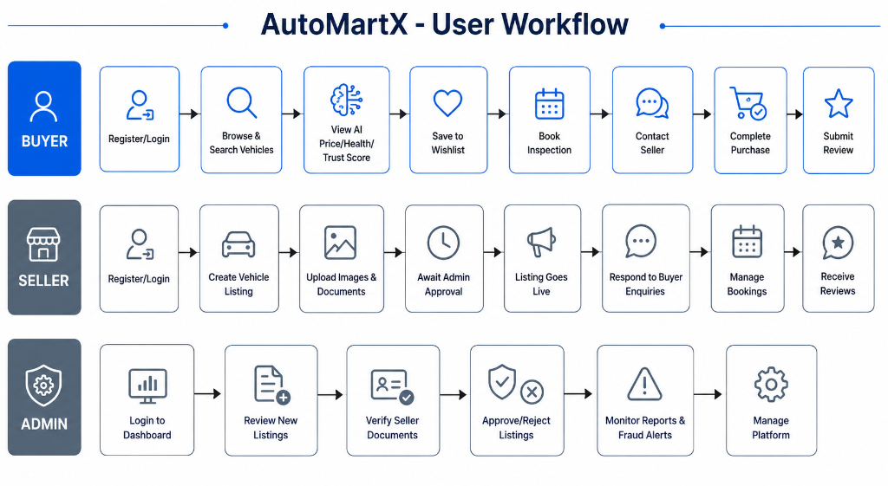

# AutoMartX - User Workflow Diagram

# 🚗 AutoMartX – AI-Powered Smart Vehicle Marketplace

---

## Overview

The following workflow diagram illustrates the step-by-step end-to-end journey for all three primary user roles (**Buyer**, **Seller**, and **Admin**) within the AutoMartX ecosystem.

---

## User Workflow Diagram

---

## Detailed Step-by-Step Breakdown

### 👤 1. Buyer Workflow
1. **Register / Login**: Secure authentication via JWT.
2. **Browse & Search Vehicles**: Advanced multi-attribute search and filtering.
3. **View AI Price / Health / Trust Score**: Review AI-generated fair price estimates, vehicle condition health score, and seller trust score.
4. **Save to Wishlist**: Save favourite vehicle listings for later review.
5. **Book Inspection**: Schedule a vehicle inspection date.
6. **Contact Seller**: Initiate direct buyer-seller messaging.
7. **Complete Purchase**: Finalize transaction directly with seller.
8. **Submit Review**: Provide feedback and star ratings post-purchase.

---

### 🚘 2. Seller Workflow
1. **Register / Login**: Account creation and login.
2. **Create Vehicle Listing**: Input vehicle specs, asking price, and description.
3. **Upload Images & Documents**: Provide high-res images and RC / verification documents.
4. **Await Admin Approval**: Listing is placed in pending state for moderation.
5. **Listing Goes Live**: Approved listing becomes visible to buyers.
6. **Respond to Buyer Enquiries**: Answer questions from interested buyers.
7. **Manage Bookings**: View and confirm inspection bookings.
8. **Receive Reviews**: Build long-term trust score from buyer feedback.

---

### 🛡️ 3. Admin Workflow
1. **Login to Dashboard**: Administrative access.
2. **Review New Listings**: Moderate newly submitted vehicle listings.
3. **Verify Seller Documents**: Validate uploaded ownership documents and ID proofs.
4. **Approve / Reject Listings**: Publish valid listings or reject fraudulent submissions.
5. **Monitor Reports & Fraud Alerts**: Review AI-generated fraud warnings and user complaints.
6. **Manage Platform**: Oversee user accounts, categories, and system health.
